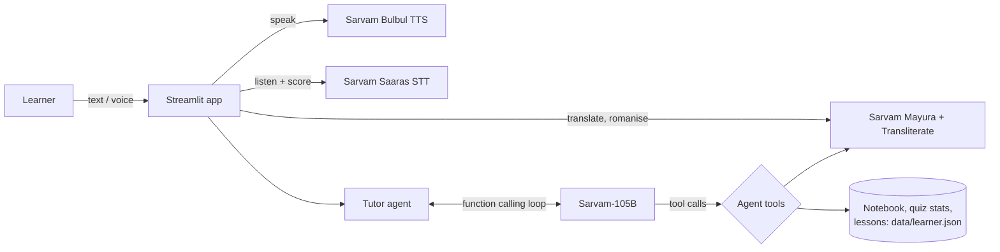

# 🪔 Hindi Saathi (हिंदी साथी): AI Hindi tutor and translator, powered by Sarvam AI

**Hindi Saathi** helps a beginner who knows a little Hindi become confident. You can **translate** anything, **hear** it spoken by a natural Indian voice, **say it yourself** and get a pronunciation score, then **learn** with an AI tutor agent that teaches lessons, quizzes you and remembers your words.

Every AI task runs on **[Sarvam AI](https://www.sarvam.ai/) APIs**.

---

## 1. The MVP: one user, one problem, one complete flow

| | |
|---|---|
| **User** | A beginner Hindi learner who knows a few words (for example someone who moved to North India, or wants to talk to family) |
| **Problem** | Translators give text but don't teach. Learners can't tell how a sentence is *pronounced* or whether *they* are saying it right |
| **Input** | A sentence in English, Hindi or Hinglish (typed), then the learner's own voice (recorded) |
| **Result** | The Hindi in Devanagari, a romanised pronunciation and the English meaning, **audio** of a native-sounding voice, a **pronunciation score** with the words to fix highlighted, and the phrase saved to a spaced-repetition notebook |

**The flow:** Type a sentence → Translate → 🔊 Listen (slow mode) → 🎤 Record yourself → Score + feedback → 📒 Save → 🧑‍🏫 "Explain the grammar" → later 🧠 Quiz / 🔄 Review in the tutor chat.

## 2. Idea → AI tasks → Sarvam APIs

| AI task in the app | Sarvam API | Model |
|---|---|---|
| Translate English ↔ Hindi (standard Hindi or casual Hinglish, auto-detects the input language) | `POST /translate` | **Mayura** `mayura:v1` |
| Show how to pronounce Devanagari in Roman letters | `POST /transliterate` | Transliteration |
| Speak the Hindi aloud (normal or 🐢 slow pace) | `POST /text-to-speech` | **Bulbul** `bulbul:v3` |
| Understand the learner's spoken Hindi for pronunciation scoring | `POST /speech-to-text` | **Saaras** `saaras:v4` |
| Tutor agent: lessons, quizzes, grammar explanations, conversation practice; decides when to call tools | `POST /v1/chat/completions` with function calling | **Sarvam-105B** `sarvam-105b` |

## 3. The tutor agent

The tutor is a function-calling agent on **Sarvam-105B**. The model decides which tools to call. The app runs them and feeds the results back until the model answers.



| Tool | What it does |
|---|---|
| `translate_text` | Accurate translation and romanisation via Sarvam Mayura + Transliterate |
| `save_vocabulary` | Adds a word to the learner's notebook |
| `get_vocabulary` | Words to review, weakest and most overdue first |
| `record_quiz_result` | Grades a word and reschedules it with Leitner spaced repetition (0/1/3/7/14 days) |
| `get_learner_profile` / `update_learner_profile` | Level, goals, accuracy, streak, weak words |
| `get_curriculum` / `mark_lesson_complete` | A 12-lesson beginner → intermediate course with progress tracking |

## 4. Setup

You need Python 3.10+ and a Sarvam API key from [dashboard.sarvam.ai](https://dashboard.sarvam.ai/) with credits.

```bash
git clone https://github.com/<your-username>/hindi-saathi.git
cd hindi-saathi
pip install -r requirements.txt
cp .env.example .env
```

Then put your key in `.env` as `SARVAM_API_KEY=...`. **Never commit `.env`**: it is already in `.gitignore`.

**Run the web app:**

```bash
streamlit run app.py
```

Open http://localhost:8501. The app has three tabs:

- 🔁 **Translate & Speak** is the core flow above.
- 💬 **Tutor chat** has 📚 Lesson / 🧠 Quiz / 🔄 Review / 💬 Chat / 📈 Progress quick actions.
- 📒 **Notebook** lists your saved words and when each is due for review.

**Or chat in the terminal:**

```bash
python cli.py
```

The terminal commands are `/lesson`, `/quiz`, `/review`, `/stats`, `/reset` and `/quit`.

**Run the tests** (offline, no key needed):

```bash
python -m unittest -v
```

### Optional settings (`.env`)

| Variable | Default |
|---|---|
| `SARVAM_CHAT_MODEL` | `sarvam-105b` |
| `SARVAM_TTS_MODEL` / `SARVAM_TTS_SPEAKER` | `bulbul:v3` / `priya` |
| `SARVAM_STT_MODEL` | `saaras:v4` |
| `HINDI_SAATHI_DATA` | `data/learner.json` |

## 5. Deploy on Streamlit Community Cloud

1. Push this repo to GitHub (the API key stays out of it).
2. Go to [share.streamlit.io](https://share.streamlit.io) → **Create app**. Pick this repo, branch `main`, main file `app.py`.
3. Under **Advanced settings → Secrets**, add:
   ```toml
   SARVAM_API_KEY = "your-key"
   ```
4. Deploy, then open the live link on another device (your phone) and test the flow, including the 🎤 mic.

## 🗂️ Project structure

```
hindi-saathi/
├── app.py                   # Streamlit web app (Translate & Speak, Tutor chat, Notebook)
├── cli.py                   # Terminal tutor chat
├── hindi_saathi/
│   ├── sarvam.py            # Sarvam REST client: chat, translate, transliterate, TTS, STT
│   ├── agent.py             # Tutor agent: Sarvam-105B function-calling loop
│   ├── tools.py             # Tool schemas + handlers
│   ├── practice.py          # Pronunciation scoring (target vs Saaras transcript)
│   ├── store.py             # Learner data, spaced repetition, streaks
│   ├── curriculum.py        # 12-lesson Hindi course
│   └── prompts.py           # Tutor system prompt
└── tests/test_tools.py      # Offline tests with a fake Sarvam client
```

Built at a hackathon with ❤️ using Sarvam AI.
